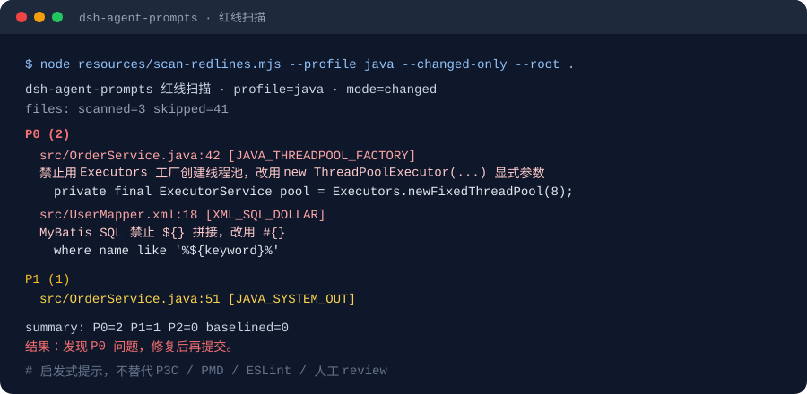

# dsh-agent-prompts

**把全栈开发规范、Spring Boot / Vue 3 工程实践、前端视觉设计与软件工程流程，做成 DeepSeek Harness 的按需技能包。**

不需要每次开新会话都粘贴长提示词：模型在任务匹配时加载对应技能，长条文放在包内、按需读取，关键红线与验收命令可直接执行。

[English](./README.en.md) · 简体中文

[](https://github.com/lw24-1936/dsh-agent-prompts/releases)
[](./LICENSE)
[](https://nodejs.org/)
[](https://dsh.market/)
[](https://github.com/topics/dsh-plugin)
[](./CONTRIBUTING.md)

## 30 秒上手

```bash
# DSH Web profile
dsh plugin --profile web add git+https://github.com/lw24-1936/dsh-agent-prompts.git

# 本地开发
dsh plugin --profile web add file:/path/to/dsh-agent-prompts
```

桌面版：**插件设置 → 安装**，填 GitHub 地址或本地目录；装完刷新页面，技能会出现在技能目录。

> npm 包尚未发布。DSH Plugin Hub 的「插件中心」只展示 npm 可安装包；在发布前请用上面的 GitHub 安装。详见 [FAQ](#faq)。

## 为什么

原来的规范是几份长文档：单体 1978 行 + 微服务 2719 行 + Java 手册约 2500 行 + 前端规范。直接贴进对话会：

- 挤占上下文，且每次新会话都要重来；
- 开发/排查、单体/微服务、Java/前端混在一起，靠人记该用哪份；
- 大量条文不可判定，真正执行时反而变成噪音。

本插件把它们拆成 **10 个按场景触发的技能**，并做三件事：

1. **渐进披露**：技能正文只放触发、决策表、核心规则、资源索引；长文在 `resources/`，命中哪节读哪节。
2. **可执行化**：P0 红线 + 两个零依赖检查器 + 提交前门禁，把“注意质量”变成能跑的命令。
3. **工程纵深**：不只代码风格，还覆盖 Spring Boot 结构/事务/测试、Vue 3 组件/状态/测试、视觉设计评审与交付证据。

## 技能矩阵

| 技能 | 何时加载 | 覆盖 |
|---|---|---|
| `alibaba-java-standards` | 写/改/review Java 或 SQL | P0 红线、三级管控、章节路由、API 速查 |
| `spring-boot-engineering` | Spring Boot 包结构/API/事务/JPA/测试/Modulith | 业务域分包、REST/ProblemDetail、Service 事务、Testcontainers/ArchUnit、Security |
| `f2e-spec` | 写/改/review JS/TS/React/Vue | 格式、Hooks、Vue 示例、SFC 块顺序、安全、a11y、ESLint/Prettier |
| `vue3-engineering` | Vue 3 组件/响应式/composables/Router/Pinia/测试 | 响应式/组件模式、SFC 顺序、生态、Vitest/Playwright、调试索引、反模式 |
| `frontend-design-craft` | 做/改/评审页面、落地页、后台、设计系统 | brief/视觉方向、评审 rubric、四视口浏览器验收、反 AI 味、设计检查器 |
| `software-engineering-process` | 新项目/新模块/大改动、排期、问“用什么流程” | 自动选择算法、流程库、DoR/DoD、证据/审查/交付纪律 |
| `fullstack-monolith-dev` | 单体全栈开发 | Vue + TS + Vite + Pinia / Spring Boot + JDK + MyBatis-Plus + Sa-Token、四套环境、RBAC、双文档、门禁 |
| `fullstack-monolith-debug` | 单体故障 | 500/401/403/404、数据不一致、慢查询、中间件 |
| `fullstack-microservice-dev` | 微服务开发 | Nacos / Gateway / OpenFeign / Sentinel / Seata、Maven 多模块、拆分/网关/事务 |
| `fullstack-microservice-debug` | 微服务链路故障 | 注册失败、网关 404、Feign 超时、熔断、Seata、MQ 堆积 |

**组合方式**：全栈技能管架构/技术栈/门禁；Java/Spring 写法交给 `alibaba-java-standards` / `spring-boot-engineering`；前端/Vue 写法交给 `f2e-spec` / `vue3-engineering`；页面视觉与设计评审交给 `frontend-design-craft`；流程选择交给 `software-engineering-process`。

## 它如何工作

```text
skills/<name>.md         触发条件 + 决策表 + 核心规则 + 资源索引 + 自检
        │
        ├── resources/alibaba-java/        Java 手册拆分章节
        ├── resources/f2e-spec/            F2E 原文 + 工具链
        ├── resources/spring-boot/         架构/API/JPA/测试/Modulith/Security
        ├── resources/vue3/                响应式/组件/生态/调试
        ├── resources/frontend-design/     brief/评审/浏览器验收/设计检查器
        ├── resources/engineering/         证据/审查/交付/简化
        ├── resources/templates/           PROCESS/REQUIREMENTS/DESIGN/REVIEW/DELIVERY
        └── resources/scan-redlines.mjs    P0 红线扫描器
```

- `lib/index.js` 用 `ctx.skills.register` 注册；每个技能声明 `resourceBase`，DSH 加载时给出资源基准目录。
- 技能正文不复制长文；模型按索引读取需要的文件，避免一次塞满上下文。
- 运行时零依赖、不访问网络；扫描器/设计检查器只读本地文件。
- 可选 `only` / `disabled` 控制注册哪些技能，见 [架构文档](./docs/ARCHITECTURE.md)。

## 流程自动选择

`software-engineering-process` 开工前读项目约束（需求稳定性、合规/安全、合同/交付节奏、团队规模、存量占比、反馈通道），按**硬约束优先**自动选择：

| 条件 | 主流程 |
|---|---|
| 高合规/安全/审计 | V-Model / 阶段门禁瀑布（阶段内可迭代） |
| 固定总价/固定范围 | 增量交付 + 基线 + 变更控制 |
| 高不确定性/未验证技术 | Spiral / 迭代式发现 |
| 持续产品、需求常变 | Scrum |
| 运维/存量维护/持续流入 | Kanban + DevOps |
| 1–3 人一次性/内部工具 | 轻量迭代 |

输出「流程选择 + 依据 + 节奏 + 产物 + 门禁 + 何时重选」，然后直接执行；缺少关键事实才问，最多 3 个问题，且问事实不问“想用 Scrum 还是瀑布”。用 [PROCESS.md](./resources/templates/PROCESS.md) 记录。

## 两个可执行门禁

### 1. Java / 前端 P0 红线扫描器

```bash
# Java（默认 P0 失败）
node "<资源目录>/scan-redlines.mjs" --profile java --root .

# 只扫 git 改动
node "<资源目录>/scan-redlines.mjs" --profile java --changed-only --root .

# 存量仓库：先建基线，只拦新增
node "<资源目录>/scan-redlines.mjs" --profile java --write-baseline .dsh/redlines-baseline.json --root .
node "<资源目录>/scan-redlines.mjs" --profile java --baseline .dsh/redlines-baseline.json --root .

# 前端 / SARIF / GitHub 注解
node "<资源目录>/scan-redlines.mjs" --profile frontend --root .
node "<资源目录>/scan-redlines.mjs" --profile java --root . --format sarif
```

安装到项目 devDependencies 后也可用 bin：

```bash
npx dsh-agent-prompts-scan --profile java --changed-only --root .
```



覆盖：Java 线程池/日期/SQL 拼接/空 catch/资源/ThreadLocal 等；前端 eval、v-html、外链 noopener、v-for key、Vue SFC 块顺序（`template → script → style`）等。它是正则级启发式，正式门禁仍用 P3C / PMD / ESLint 与人工 review；完整规则见 [SCANNER.md](./docs/SCANNER.md)。

### 2. 设计反模式检查器

```bash
node "<资源目录>/frontend-design/check-design.mjs" --root . --fail-on P1
```

只查低误报项：紫色渐变、`transition: all`、lorem ipsum、图片缺 alt、可点击 div、`outline: none`、`z-index: 9999`。**不判断好看**，不能替代四视口浏览器验收；规则与限制见 [DESIGN-CHECK.md](./docs/DESIGN-CHECK.md)。

安装到 devDependencies 后也可用 bin：

```bash
npx dsh-agent-prompts-design --root . --fail-on P1
```

## 快速示例

```text
用 software-engineering-process 判断这个项目该用什么流程
用 spring-boot-engineering 设计这个模块的 API 和测试
用 alibaba-java-standards 检查这个 Service
用 vue3-engineering 重构这个 composable
用 f2e-spec 审查这个 Vue 页面
用 frontend-design-craft 评审这个落地页
用 fullstack-microservice-dev 规范帮我搭骨架
用 fullstack-monolith-debug 流程排查这个 500
```

更完整的触发样例（含“哪个技能优先”）见 [TRIGGER-MATRIX.md](./docs/TRIGGER-MATRIX.md)。

## 配置

```yaml
# profile 的 cordis 配置（按实际位置调整）
dsh-agent-prompts:
  only: [spring-boot-engineering, vue3-engineering]
  # 或
  disabled: [fullstack-microservice-debug]
```

- 必须是字符串数组；非法类型忽略并 warn；重复名去重；未知名 warn。
- `only` 优先于 `disabled`；不传时注册全部。
- 详见 [ARCHITECTURE.md](./docs/ARCHITECTURE.md)。

## 版本策略：不锁技术版本

- Spring Boot / Spring Cloud / JDK / Vue / MySQL / ESLint / TypeScript 等，以项目 `pom.xml` / `build.gradle` / `package.json` / 父 POM / BOM 为准。
- 示例中的版本只说明兼容关系，不是升级指令；没有版本信息时先问用户。
- Vue 2 / Boot 2 / JDK 8/11/17 等项目不因加载技能而被要求迁移；技能给等价写法。
- 本包自身 Node 下限见 `package.json`；DSH 宿主可能要求更高。

## 项目接入

把 [resources/AGENTS.snippet.md](./resources/AGENTS.snippet.md) 追加到项目根 `AGENTS.md`，让 agent 进入项目就知道加载哪些技能、提交前跑什么检查。片段包含：

- Java/Spring/前端/Vue/设计/流程的加载规则；
- “被触碰代码”的 git 判定；
- 扫描器/设计检查器命令；
- 交付证据与不假报要求。

流程选择用 [PROCESS.md](./resources/templates/PROCESS.md) 记录；需求/设计/审查/交付分别用 [REQUIREMENTS](./resources/templates/REQUIREMENTS.md)、[DESIGN](./resources/templates/DESIGN.md)、[REVIEW](./resources/templates/REVIEW.md)、[DELIVERY](./resources/templates/DELIVERY.md)。

## 文档

| 文档 | 内容 |
|---|---|
| [AGENTS.md](./AGENTS.md) | 本仓库的 agent 维护指南（命令、技能编写、发布） |
| [ARCHITECTURE.md](./docs/ARCHITECTURE.md) | 插件注册、渐进披露、配置、兼容性 |
| [SCANNER.md](./docs/SCANNER.md) | 红线扫描器完整规则/配置/baseline |
| [DESIGN-CHECK.md](./docs/DESIGN-CHECK.md) | 设计检查器用法/规则/限制 |
| [TRIGGER-MATRIX.md](./docs/TRIGGER-MATRIX.md) | 22 条触发样例与重叠处理 |
| [REFERENCE-SKILL-ANALYSIS.md](./docs/REFERENCE-SKILL-ANALYSIS.md) | 8 个参考 Skill 的吸收映射与“未照搬”清单 |
| [SKILL-AUTHORING.md](./docs/SKILL-AUTHORING.md) | 技能编写实践 |
| [CHANGELOG.md](./CHANGELOG.md) | 版本变更 |
| [PUBLISH.md](./PUBLISH.md) | 发布/市场提交记录 |
| [CONTRIBUTING.md](./CONTRIBUTING.md) / [SECURITY.md](./SECURITY.md) | 贡献与漏洞报告 |

## 开发与验证

```bash
npm run check        # 语法检查
npm test             # node:test：注册/内容/扫描器/设计检查/tarball
npm run verify       # check + test（提交前必须）
npm pack --dry-run   # 检查打包内容
npm run check:design # 对本仓库跑设计检查器
```

新增/修改技能时同步更新：`lib/index.js`、`test/content.test.mjs`、`test/plugin.test.mjs`、`test/tarball.test.mjs`、README、AGENTS、CHANGELOG。详见 [AGENTS.md](./AGENTS.md)。

## 兼容性

- DSH 需要支持 `ctx.skills.register` 与 `resourceBase`。
- Node.js >= 20（本包自身；DSH 宿主可能要求更高）。
- Windows / macOS / Linux；`--changed-only` 需要 git。

## FAQ

<details>
<summary><b>为什么在 DSH Plugin Hub 的“插件市场”搜不到？</b></summary>

DSH Plugin Hub 的「插件中心」只展示能用 npm 一键安装的包；本包尚未发布 npm。DSH Market 已收录条目 `lw24-1936/dsh-agent-prompts`，安装命令走 GitHub。详见 [PUBLISH.md](./PUBLISH.md)。
</details>

<details>
<summary><b>没有 npm 包，现在怎么装？</b></summary>

```bash
dsh plugin --profile web add git+https://github.com/lw24-1936/dsh-agent-prompts.git
```

桌面版在「插件设置 → 安装」填这个地址，或填本地目录。
</details>

<details>
<summary><b>扫描器/设计检查器会改代码吗？</b></summary>

不会。它们只读本地文件，不执行目标代码，不访问网络；修复需要结合上下文人工完成。
</details>

<details>
<summary><b>它和普通 linter 有什么区别？</b></summary>

P3C/PMD/ESLint 是完整规则引擎；本包是**上下文加载 + 启发式门禁**，负责让 agent 在正确时机加载正确规范，并用少量高价值检查提醒。两者互补，不替代。
</details>

## 许可与致谢

- 插件代码与执行层改写：MIT，见 [LICENSE](./LICENSE)。
- Java 规约：《Java 开发手册（黄山版）》v1.7.1，版权归阿里巴巴集团；封装参考 [Sxuan-Coder/alibaba-java-development-guide](https://github.com/Sxuan-Coder/alibaba-java-development-guide)（MIT）。
- 前端规约：[alibaba/f2e-spec](https://github.com/alibaba/f2e-spec)（MIT）。
- 0.6.0 起参考的 8 个公开 Skill/仓库及“未照搬”清单：[REFERENCE-SKILL-ANALYSIS.md](./docs/REFERENCE-SKILL-ANALYSIS.md)。
- 完整第三方声明：[NOTICE.md](./NOTICE.md)。

---

如果这个插件帮你少贴了几次长提示词，欢迎 star、提 issue 或按 [CONTRIBUTING.md](./CONTRIBUTING.md) 贡献。
