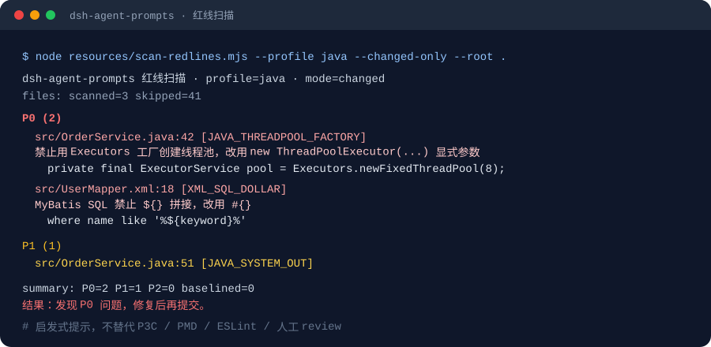

# dsh-agent-prompts

把「全栈开发 / 问题排查」与「阿里巴巴 Java / 前端规约」做成 **DeepSeek Harness 技能包**：装上之后不用再手动粘贴长提示词，模型会在合适的场景自行加载对应规范。

[English](./README.en.md) · 简体中文

[](https://github.com/lw24-1936/dsh-agent-prompts)
[](./LICENSE)
[](https://dsh.market/)
[](https://github.com/topics/dsh-plugin)

## 它解决什么问题

原来这些规范是几份长文档：单体 1978 行 + 微服务 2719 行，外加《阿里巴巴 Java 开发手册》约 2500 行与一份前端规范。直接贴进对话有三个问题：

1. 每次开新会话要重新贴，贴多了挤占上下文；
2. 开发 / 排查、单体 / 微服务、Java / 前端混在一起，靠人记该用哪份；
3. 大量条文是重复或不可判定的表述，真正执行时反而是噪音。

本插件把它们拆成 **7 个按场景触发的技能**，并做了五件事：

- **压缩与结构化**：只保留硬约束、流程、门禁与可执行断言；
- **渐进披露**：长条文（Java 手册 8+1 节、原始全栈文档）放在资源目录；原「编程规约」1036 行已拆成 8 个文件（`01a`–`01h`），命中哪节只读哪节；
- **可执行化**：P0 红线 + 红线扫描器 + 提交前门禁，把「注意代码质量」变成能跑的命令；
- **存量友好**：扫描器支持 `--changed-only`、`--baseline`、`.dsh/redlines.json`、SARIF / GitHub 注解，老仓库可以先建基线、只拦新增问题；
- **流程自动选择**：按需求稳定性、合规/安全、合同、风险、团队与存量占比，自动选 Waterfall / V-Model / 增量 / 迭代 / Spiral / Scrum / Kanban / XP / DevOps，不先让用户选方法论。

## 七个技能

| 技能 | 何时自动加载 | 正文 |
|---|---|---|
| `alibaba-java-standards` | 写/改/review Java 或 SQL：线程池、日期、SQL 注入、资源、异常、集合、ThreadLocal | P0 红线 + 三级管控 + 章节路由 + API 速查 |
| `f2e-spec` | 写/改/review JS/TS/React/Vue（版本按项目）：格式、Hooks、Vue 3 示例、安全、a11y | 规则分级 + 工具链 + Review 格式 |
| `software-engineering-process` | 新项目/新模块/大改动、排期拆分、用户问「用什么流程」、现有流程不适配 | 自动选择算法 + 流程库 + 场景模板 + DoR/DoD + 度量 |
| `fullstack-monolith-dev` | 单体全栈开发：Vue + TS + Vite + Pinia / Spring Boot + JDK + MyBatis-Plus + Sa-Token（版本按项目） | 技术栈与版本策略、四套环境、RBAC、双文档、门禁 |
| `fullstack-monolith-debug` | 单体故障排查：500/401/403/404、数据不一致、慢查询、连不上中间件 | 定位流程 + 分层清单 + 排查记录 |
| `fullstack-microservice-dev` | 微服务开发：Nacos / Gateway / OpenFeign / Sentinel / Seata + Maven 多模块 | 版本读取、拆分、模块、网关、事务 |
| `fullstack-microservice-debug` | 微服务链路排查：注册失败、网关 404、Feign 超时、熔断、Seata 不回滚、MQ 堆积 | 逐跳定位 + 故障速查 |

两个标准技能 + 一个流程技能是**横切能力**：四个全栈技能管架构、技术栈、环境与门禁；Java / 前端代码怎么写，交给两个标准技能；项目该用哪种开发流程，交给 `software-engineering-process` 自动判断。

## 版本策略：不锁技术版本

- **不硬绑版本**：Spring Boot / Spring Cloud / Spring Cloud Alibaba / JDK / Vue / MySQL / ESLint / TypeScript 等，都以项目 `pom.xml` / `build.gradle` / `package.json` / 父 POM / BOM 为准。
- **示例不是要求**：文档里的 `3.5.x`、`2025.0.x`、`JDK 21`、`ESLint 9` 等只用于说明兼容关系，不是升级指令；项目没有这些版本时按项目实际版本给等价写法。
- **先检测再写代码**：没有版本信息时先问用户；不凭记忆写版本号，不擅自升降级。
- **升级是项目决策**：需要升级时先给影响面、兼容矩阵与回归清单，由用户确认。
- **存量优先**：Vue 2 / Spring Boot 2 / JDK 8/11/17 等项目不因技能加载而被要求迁移；技能给出对应版本的等价写法。

## 三级管控：为什么 P0 要单独拎出来

规约自身的【强制】/【推荐】/【参考】不等于执行时的优先级。本插件按「违反后果」分三层：

| 层级 | 覆盖 | 行为 |
|---|---|---|
| 🔴 **P0 红线** | 线程池、并发安全、安全漏洞、资源与事务、NPE、破坏性 SQL、XSS | 新代码直接合规；**被本次 diff 触碰到的存量代码**发现即修复；不可口头豁免 |
| 🟡 **P1 新代码强制** | 命名、常量、格式、OOP、注释、分层等风格/结构类 | 只约束新增/重写代码；存量不扫描、不重命名、不刷屏 |
| 🟢 **P2 建议** | 【推荐】/【参考】 | 提示不阻塞；用户说忽略即忽略 |

老仓库代码再乱也不怕：P1 只管新写的代码；但被改到的文件里如果出现 `Executors.newFixedThreadPool`、`SimpleDateFormat`、`${}` 拼接 SQL、空 `catch`、集合 `return null` 这类 P0，必须顺手修掉——这正是 CI 质量门禁会阻断的项。

## 流程自动选择：不先让你选方法论

`software-engineering-process` 在开工前读项目约束（需求稳定性、合规/安全、合同/交付节奏、团队规模、存量占比、反馈通道），按**硬约束优先**自动选择：

| 条件 | 主流程 |
|---|---|
| 高合规/安全/审计 | V-Model / 阶段门禁瀑布（阶段内可迭代） |
| 固定总价/固定范围 | 增量交付 + 基线 + 变更控制 |
| 高不确定性/未验证技术 | Spiral / 迭代式发现 |
| 持续产品、需求常变 | Scrum |
| 运维/存量维护/持续流入 | Kanban + DevOps |
| 1–3 人一次性/内部工具 | 轻量迭代 |

它输出「流程选择 + 依据 + 节奏 + 产物 + 门禁 + 何时重选」，然后直接执行；缺少关键事实才问，最多 3 个问题，且问事实不问「想用 Scrum 还是瀑布」。完整流程库、场景模板、DoR/DoD、度量与反模式见 [software-engineering-process.md](./skills/software-engineering-process.md)；项目落地用 [templates/PROCESS.md](./resources/templates/PROCESS.md) 记录。

## 渐进披露：长条文不占常驻上下文

技能正文只放执行策略与路由；完整内容放在包内资源目录：

```
resources/
├── alibaba-java/          # 01a–01h 拆分章节 + 02–08 + 09 现代 Java + 索引/模板
├── f2e-spec/              # F2E 原始快照 + ESLint/Prettier/tsconfig 配置
├── examples/              # 6 组 before/after 示例
├── reference/             # 历史原文（版本锁定不生效）
├── templates/             # PROCESS.md 等项目模板
├── AGENTS.snippet.md      # 项目 AGENTS.md 自动加载片段
└── scan-redlines.mjs      # Java / 前端 P0 启发式扫描器
```

每个技能注册时声明 `resourceBase`，DSH 加载技能时会给出资源基准目录；模型命中具体主题（如「金额用 BigDecimal 还是 Long」「索引最左前缀」）时，才去读对应章节。拆分后单文件 3–13 KB，避免为了查一条命名规则载入整章 68 KB。

## 安装

### 方式一：GitHub（当前推荐，无需 npm 发布）

```bash
dsh plugin --profile web add git+https://github.com/lw24-1936/dsh-agent-prompts.git
```

桌面版（`desktop` profile 被 Electron 独占，命令行只对 `web` 有效）：打开 **插件设置 → 安装**，填入上面的 GitHub 地址；也可以填本地目录。

### 方式二：本地开发

```bash
dsh plugin --profile web add file:/path/to/dsh-agent-prompts
```

### 方式三：npm（0.5.1 发布后可用）

```bash
dsh plugin --profile web add dsh-agent-prompts
```

> 仓库已提交 DSH Market（条目 `lw24-1936/dsh-agent-prompts`）与 DSH Plugin Hub（收录 issue [#581](https://github.com/dshplugin/dsh-plugin-hub/issues/581)，源码安装）。**截图里的「DSH Plugin Hub → 插件市场」只展示能用 npm 一键安装的包**；在 npm 发布前，请用方式一。DSH Market 的 GitHub 安装命令已通过数据修正 [#313](https://github.com/2BingLing/dsh-market/issues/313) 更新。

装完重启 Harness（桌面版刷新页面）后，技能会出现在技能目录。

## 用法

装好后不需要任何操作。当你提出「新建一个 Spring Boot 项目」「这个接口 500 了帮我查」「这段 Java 有没有阿里规约问题」「审查这个 Vue 组件」这类请求时，对应技能会出现在技能目录里，由模型按需加载。新项目/新模块会先由 `software-engineering-process` 读项目约束自动选择流程，不会先问你「选 Scrum 还是瀑布」。

也可以显式触发（在对话里说出技能名）：

```
用 software-engineering-process 判断这个项目该用什么流程
用 alibaba-java-standards 检查这个 Service
用 f2e-spec 审查这个 Vue 页面
用 fullstack-microservice-dev 规范帮我搭骨架
用 fullstack-monolith-debug 流程排查这个 500
```

## 红线扫描器

标准技能里带一个零依赖的启发式扫描器，用来在提交前抓最容易踩的 P0 反例。作为 DSH 插件安装时，脚本在技能的资源基准目录下：



```bash
# Java / SQL（默认 P0 失败）
node "<资源目录>/scan-redlines.mjs" --profile java --root .

# 只扫 git 改动（工作区 + 暂存 + 未跟踪）
node "<资源目录>/scan-redlines.mjs" --profile java --changed-only --root .

# 存量仓库：先建基线，之后只拦新增问题
node "<资源目录>/scan-redlines.mjs" --profile java --write-baseline .dsh/redlines-baseline.json --root .
node "<资源目录>/scan-redlines.mjs" --profile java --baseline .dsh/redlines-baseline.json --root .

# 前端
node "<资源目录>/scan-redlines.mjs" --profile frontend --root .

# CI 格式
node "<资源目录>/scan-redlines.mjs" --profile java --root . --format sarif > redlines.sarif
node "<资源目录>/scan-redlines.mjs" --profile java --root . --format github
```

如果项目把本包装进了 devDependencies（`npm i -D dsh-agent-prompts`），可以用 bin：

```bash
npx dsh-agent-prompts-scan --profile java --changed-only --root .
```

资源目录就是技能加载时给出的 base directory（通常为 `<包目录>/resources`）。

### 常用选项

| 选项 | 作用 |
|---|---|
| `--changed-only` / `--base <ref>` | 只扫 git 改动；默认基准 `HEAD` |
| `--baseline <file>` | 过滤已记录的存量问题，只对新问题失败 |
| `--write-baseline <file>` | 把当前问题写入基线并退出 0 |
| `--fail-on P0\|P1\|P2\|none` | 退出码阈值，默认 P0 |
| `--ignore rule1,rule2` | 临时忽略规则 |
| `--format text\|json\|sarif\|github` | 输出格式；`--json` 等价 json |
| `--config <file>` | 配置文件，默认 `<root>/.dsh/redlines.json` |

配置文件示例：

```json
{
  "ignoreRules": ["F2E_CONSOLE"],
  "ignorePaths": ["**/generated/**", "**/*.d.ts"],
  "severity": { "JAVA_SYSTEM_OUT": "P2" },
  "failOn": "P0"
}
```

也支持按 profile 覆盖：`{ "java": { ... }, "frontend": { ... } }` 或 `{ "profiles": { "java": { ... } } }`。

覆盖范围：

- **Java**：`Executors` 工厂、裸 `new Thread`、`SimpleDateFormat`、`java.util.Date`/`Calendar`、空 `catch`、MyBatis `${}`、无 `where` 的 update/delete、集合 `return null`、`ThreadLocal` 未 `remove`、`printStackTrace`、`System.out`、`new BigDecimal(double)`。
- **前端**：`eval`/`new Function`、`v-html`、`dangerouslySetInnerHTML`、`target="_blank"` 缺 `noopener`、`v-for` 缺 key、`v-if`+`v-for`、`var`、`==`、`any`、`debugger`、`console`、`@ts-ignore`、`innerHTML`。

准确性说明：

- 扫描前会去掉注释，并把字符串内容遮罩（SQL/HTML 规则例外），所以「注释里写了 `SimpleDateFormat`」不会误报；`v-html="DOMPurify.sanitize(x)"` 会降为 P2 提示。
- 仍是正则级启发式，不替代 P3C / PMD / ESLint / 人工 review；存在少量误报与漏报。
- 不自动修代码：修复需要结合上下文，自动改可能引入更大问题。

完整规则表、配置、baseline、SARIF 与 CI 接入见 [docs/SCANNER.md](./docs/SCANNER.md)。

## 项目接入：AGENTS.md 片段

把 [resources/AGENTS.snippet.md](./resources/AGENTS.snippet.md) 追加到项目根 `AGENTS.md`，agent 进入项目就知道该加载哪些技能、提交前跑什么检查。片段同时说明「被触碰代码」的 git 判定与基线用法。流程选择结果按 [templates/PROCESS.md](./resources/templates/PROCESS.md) 记录，约束变化时更新。

## 示例

`resources/examples/` 有 6 组 before/after：

| 文件 | 主题 |
|---|---|
| `java-threadpool.md` | 线程池显式参数、命名、拒绝策略 |
| `java-datetime.md` | `java.time`、`DateTimeFormatter`、时区 |
| `java-sql.md` | SQL 注入、无 where 的 update/delete |
| `java-empty-catch.md` | 异常分类、日志、业务异常 |
| `vue-key.md` | Vue 列表 key、v-if/v-for（Vue 3 示例） |
| `xss.md` | HTML 消毒、外链 noopener |

## 相对原文档做了什么优化

| 项 | 原文档 | 本插件 |
|---|---|---|
| 结构 | 编号章节平铺，H1 混在中段 | 统一「前置 → 硬绑定 → 约定 → 流程 → 门禁 → 提问触发」 |
| 长度 | 单体 1978 行 / 微服务 2719 行 / Java 手册约 2500 行 | 每个技能约 150–300 行；长条文进资源目录按需读 |
| 重复 | 环境变量、自检清单、禁止事项多处重复 | 去重，每个约束只出现一次 |
| 可判定性 | 部分要求无法判定（"注意代码质量"） | 改成可检查的断言、命令、门禁 |
| 自检清单 | 60+ 项勾选，实际不会逐条执行 | 压成 10–12 条提交前门禁，附扫描器 |
| 顺序 | 开发与排查混在同一文件 | 按「单体/微服务 × 开发/排查」四象限拆分 |
| Java 规约 | 整本手册塞 prompt 会爆上下文 | 执行层 + 8 章按需路由 + P0 token 内联到 description |
| 前端规约 | 原始 Skill 部分规则停留在 class 组件时代 | 现代化为 Hooks / TS / Vue（Vue 3 示例），并加 P0 安全分级 |
| 原文 | —— | 完整保留在 `resources/`（含 `resources/reference/`），可随时对照 |

**没有删掉任何硬约束**：技术栈版本、四套环境、包结构、Feign 契约位置、网关规则、RBAC、双文档同步、验证命令、Java P0 红线、前端安全规则全部保留并改写成可执行形式。

## 目录

```
dsh-agent-prompts/
├── package.json
├── cordis.patch.yml           # profile 补丁：插入一条插件行
├── lib/index.js               # 注册 7 个技能，声明 resourceBase
├── skills/                    # 技能正文（改文案不用改代码）
│   ├── alibaba-java-standards.md
│   ├── f2e-spec.md
│   ├── software-engineering-process.md
│   ├── fullstack-monolith-dev.md
│   ├── fullstack-monolith-debug.md
│   ├── fullstack-microservice-dev.md
│   └── fullstack-microservice-debug.md
├── resources/
│   ├── scan-redlines.mjs
│   ├── alibaba-java/          # 00-index + 01a–01h + 02–08 + 09 + project-template
│   ├── f2e-spec/              # original + toolchain
│   ├── examples/              # 6 组 before/after
│   ├── reference/             # 历史原文（版本锁定不生效，见 reference/README.md）
│   └── AGENTS.snippet.md      # 项目 AGENTS.md 片段
├── test/                      # node:test：注册契约 + 扫描器 + 内容 + tarball
├── docs/SCANNER.md            # 扫描器完整文档
├── .github/workflows/         # ci.yml（Node 20/22/24）+ release.yml（tag 自动 GitHub Release）
├── CHANGELOG.md
├── NOTICE.md                  # 来源与许可
├── PUBLISH.md                 # 发布 / 市场提交记录
├── README.en.md               # 英文简介
└── README.md
```

## 实现说明

- 纯 Host 插件，没有 client 半，不占侧边栏、不发起网络请求。
- `inject: ['skills']` 是硬依赖：技能服务不存在时插件不激活，不会出现「装了但没效果」。
- 技能正文运行时读盘（`skills/*.md`），改文案后重启即可生效，不用重新构建。
- 每个技能注册 `resourceBase` 并统一指向 `resources/`：章节条文、原始文档、示例与扫描器都在同一基准目录下。
- `apply` 返回组合 disposer：插件卸载时注销全部技能，不留下幽灵条目。
- 注册 `source: 'bundled'`，`invocation` 同时允许模型与用户触发。
- 可选配置 `only` / `disabled`（profile 的 cordis 配置）：只注册或排除指定技能，名字用 kebab-case；不传时注册全部。
- 扫描器注册为 npm bin `dsh-agent-prompts-scan`，也保留 `resources/scan-redlines.mjs` 直接执行方式。
- 无运行时依赖；`npm test` 用 `node:test`，`npm run check` 做语法检查。

## 开发与验证

```bash
npm run check    # node --check lib/index.js + scanner
npm test         # 注册契约、内容、扫描器、tarball 集成
npm run verify   # 以上两项
npm pack --dry-run

# 手动跑扫描器
npm run scan:java -- --root .
npm run scan:frontend -- --root .
```

CI（`.github/workflows/ci.yml`）在 Node 20 / 22 / 24 上跑 `npm run verify`，并检查 tarball 安装后的 7 个技能与资源文件；推 `v*` tag 时 `release.yml` 自动创建 GitHub Release。

## 兼容性

- DeepSeek Harness：使用 `ctx.skills.register` 与 `resourceBase`，要求当前 DSH 版本（2026.10/11 桌面版实测）。
- Node.js：>= 20（插件自身；DSH 宿主对 Node 的要求以 DSH 为准；扫描器与测试使用 `node:test`、ESM）。
- 扫描器零依赖，可在任意 Node 20+ 环境单独运行。
- 平台：Windows / macOS / Linux；扫描器的 `--changed-only` 需要 git。

## 版本

- **0.5.1**：补齐流程技能的项目模板 `templates/PROCESS.md`、AGENTS 片段中的 7 个技能名、单体/微服务描述与流程联动；内容测试覆盖模板与引用。
- **0.5.0**：新增 `software-engineering-process`，按项目约束自动选择 Waterfall / V-Model / 增量 / 迭代 / Spiral / Scrum / Kanban / XP / DevOps / 混合门禁，并给出节奏、产物、门禁与重选条件；四个全栈技能与 AGENTS 片段接入流程选择。
- **0.4.0**：移除技术版本硬绑定——Spring Boot / Spring Cloud / JDK / Vue / MySQL / ESLint 等版本改为从项目 POM/BOM/package.json 读取；Java 现代写法按项目 JDK 选择；Node 引擎下限放宽到 20；同步文档与 CI。
- **0.3.0**：Java 第一章拆成 8 个文件 + 新增现代 Java 补充（按项目 JDK）；扫描器增加 bin、`--changed-only`、`--baseline`、SARIF/GitHub 格式、配置文件与误报抑制；新增示例、AGENTS 片段、内容/tarball 测试与 CI；文档补充 FAQ/英文简介。
- **0.2.0**：新增 `alibaba-java-standards`、`f2e-spec`；6 个技能全部声明 `resourceBase`；新增红线扫描器、测试与门禁；文档重写。
- **0.1.0**：四个全栈技能（单体/微服务 × 开发/排查）首版。

详见 [CHANGELOG.md](./CHANGELOG.md)。

## FAQ

### 为什么在 DSH Plugin Hub 的「插件市场」搜不到？

你搜的是另一个市场。DSH 侧边栏可能同时装了两个市场：

| 市场 | 数据源 | 收录方式 |
|---|---|---|
| **DSH Market** | `dsh.market` / `@dsh-market/plugin` | GitHub topic + 数据修正；本插件已收录 |
| **DSH Plugin Hub** | `dsh-plugin.org` / `dsh-plugin` | 公开仓库 + `dsh-plugin` topic + 提交 issue；本插件已提交 [#581](https://github.com/dshplugin/dsh-plugin-hub/issues/581) |

DSH Plugin Hub 的 FAQ 明确写着：**「插件中心」只展示能用 npm 一键安装的插件**。没有 npm 包的仓库只做网页收录（源码安装），不会出现在插件中心的搜索结果里。本插件 npm 包尚未发布，所以在「插件市场」搜索是 0 条。

### 没有 npm 包，现在怎么装？

用 GitHub：

```bash
dsh plugin --profile web add git+https://github.com/lw24-1936/dsh-agent-prompts.git
```

桌面版在「插件设置 → 安装」填这个地址；也可以填本地目录。

### DSH Market 和 DSH Plugin Hub 要装哪个？

装哪个都能用本插件，它们只是发现/安装入口不同。DSH Market 已收录本插件；DSH Plugin Hub 需要 npm 包才会进入插件中心。不要为了本插件重复装两个市场。

### 扫描器为什么有误报/漏报？

它是零依赖的正则级启发式：会先去掉注释、遮罩字符串，但对复杂表达式、动态拼接、跨文件数据流仍然只能给提示。正式门禁请用 P3C / PMD / ESLint + 人工 review。误报可以用 `--ignore` 或 `.dsh/redlines.json` 的 `ignoreRules` / `ignorePaths` / `severity` 处理。

### 为什么不做自动修复？

P0 修复涉及线程池参数、事务边界、SQL 语义、组件 key 选择等上下文；自动改容易把「能跑」改成「更难查」。本插件只负责定位、给出正例和门禁，修复由 agent 在理解上下文后完成。

## 安全边界

- 插件只注册技能，读取包内 `skills/` 与 `resources/`；不发起网络请求，不修改项目文件。
- 扫描器只读本地文件、不执行目标代码、不访问网络；配置与 baseline 是本地 JSON。
- 扫描器不是安全扫描器，也不构成合规认证；它只覆盖列出的启发式规则。
- 技能会建议 agent 执行构建/测试命令（`mvn`、`pnpm`、`eslint` 等），这些命令按项目与你的权限执行。

## 来源与许可

- 插件封装代码：MIT。
- Java 规约条文：《Java 开发手册（黄山版）》v1.7.1，版权归阿里巴巴集团；封装参考 [Sxuan-Coder/alibaba-java-development-guide](https://github.com/Sxuan-Coder/alibaba-java-development-guide)（MIT）。
- 前端规约：[alibaba/f2e-spec](https://github.com/alibaba/f2e-spec)（MIT）；原始 Skill 快照在 `resources/f2e-spec/original.md`。
- 全栈原始文档：随包保留在 `resources/reference/`，版权归原作者，仅作对照。

完整声明见 [NOTICE.md](./NOTICE.md)。

## 链接

- GitHub：https://github.com/lw24-1936/dsh-agent-prompts
- DSH Market：https://dsh.market/（搜索 `dsh-agent-prompts`）
- 发布记录：[PUBLISH.md](./PUBLISH.md)
